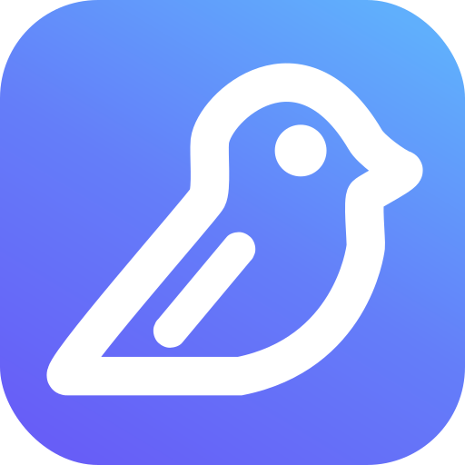

# Screenbird plugin

Manage your [Screenbird](https://screenbird.app) digital signage screens from Claude Code, Cursor and other AI apps: see what is live, put content on a screen and create designs.

## What's included

- **Connector**: the Screenbird MCP server at `https://mcp.screenbird.app/mcp`.
- **`show-on-screen`**: show content on a screen or sub-screen, now or until a set time, and switch it back afterwards.
- **`make-a-design`**: create a menu, announcement or poster from a description, then show it on a screen.
- **`check-screens`**: see which screens are offline and what each one is showing, and get help setting up a new screen.

## Installation

### Claude Code

```
/plugin marketplace add screenbird-app/screenbird-plugin
/plugin install screenbird@screenbird
```

### Cursor

[](https://cursor.com/install-mcp?name=screenbird&config=eyJ1cmwiOiJodHRwczovL21jcC5zY3JlZW5iaXJkLmFwcC9tY3AifQ==)

### Claude.ai and ChatGPT

Add a connector with the address `https://mcp.screenbird.app/mcp`. See [Use Screenbird in Claude and ChatGPT](https://screenbird.app/en/help/getting-started/claude-chatgpt) for step-by-step instructions.

## Signing in

The first time a request needs your account, you are asked to sign in to Screenbird. You then choose a team and review what the app may do. You need a Screenbird account with an active subscription.

You can disconnect at any time in Screenbird under **Settings**, then **Connections**. You receive an email whenever an app is connected to your account.

## Permissions

Without signing in, the assistant can search the Screenbird help center, give installation steps for a device and check whether a device works with Screenbird.

After you connect, and only within the team you chose, it can:

- See your screens, whether they are online and what they are showing.
- Find your files, designs and apps.
- Show content on a screen or sub-screen, permanently or until a time you set, and switch a screen back to its normal content.
- Create designs. Each design counts toward your account's AI budget, with at most 20 designs per hour.

It cannot delete anything, change playlists or schedules, pair screens or see your billing.

## Support

- Help center: [screenbird.app/en/help](https://screenbird.app/en/help)
- Privacy policy: [screenbird.app/en/privacy](https://screenbird.app/en/privacy)
- Terms of service: [screenbird.app/en/terms](https://screenbird.app/en/terms)

## License

[MIT](LICENSE)
